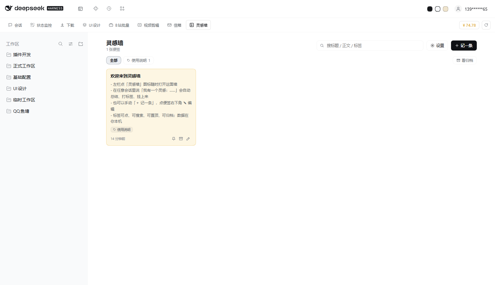
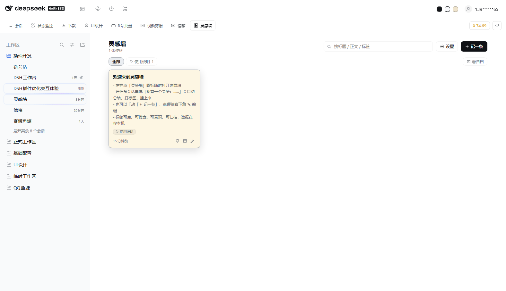
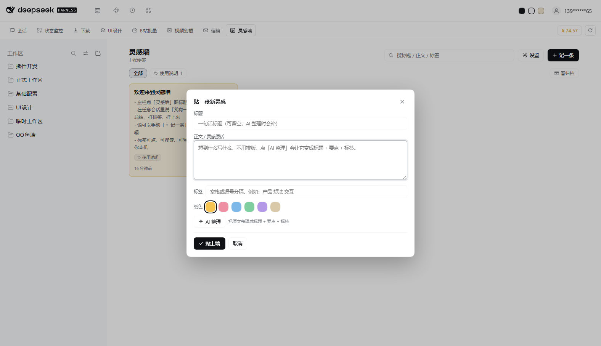

<h1 align="center">灵感墙 · dsh-idea-wall</h1>

<p align="center">
DeepSeek Harness 的便签墙插件：左栏一面墙随手贴灵感；<br>
<b>在会话里说一句「我有一个灵感……」，插件自己总结、打标签、挂上墙。</b>
</p>

<p align="center">
  
  
  
</p>

## 效果 📸

| 工作台里的「灵感墙」tab | 悬停反馈 |
|---|---|
|  |  |

| 编辑弹窗 |
|---|
|  |

## 功能 ✨

- **左栏一面墙**：便签网格、六种纸色、自由多标签、搜索、标签筛选、置顶、归档。
- **会话自动捕获**：在任意会话里说「我有一个灵感：xxx」「记一条灵感：xxx」「记到墙上：xxx」，插件抓这条消息，调一次模型归纳成「标题 + 要点 + 标签 + 纸色」，挂墙，并在会话里回一条 `[灵感墙] 已自动挂上「…」` 的运行时快照，告诉模型不要再重复添加。
- **AI 工具**：`idea_wall_add / list / update / remove`，模型也能主动挂、查、改、撕。
- **交互反馈**：所有可点击元素都有 hover / active / focus-visible 反馈（注入式 CSS，便签卡有抬起阴影）；图标全部是内联 SVG，不用字符。
- **工作台/原生侧栏双形态**：装了 [@philomelcc/dsh-workbench](https://github.com/philomelcc/dsh-workbench) 就进顶部模块 tab；没装就退回原生侧栏入口。
- **数据本机**：`$DSH_HOME/idea-wall/store.json`（默认 `~/.dsh/idea-wall/store.json`），原子写 + 损坏自动备份。

## 安装 📦

```bash
# 从本地目录 link 安装（开发/自用）
dsh plugin --profile web add link:/absolute/path/to/dsh-idea-wall

# 或让插件管理器指向这个目录
```

装完**刷新页面**即可（首次装新包不用重启 3080；如果你改的是已装包的 `client.js`，重新装一次让 bundle 重建，或重启）。

> 本包名是 `@local/dsh-idea-wall`（个人 link 用）。要发布到 npm 或给别人装，把 `package.json` 的 `name` 改成你自己的 scope 再发。

## 使用 🖊️

1. 打开工作台 → 顶部「灵感墙」tab（没装工作台时是左栏「灵感墙」图标）。
2. 看右上角：搜索、设置、**记一条**。
3. 手动贴一张：「记一条」→ 写标题/正文/标签/纸色；点「AI 整理」会把原文变成标题 + 要点 + 标签。
4. 便签右下角：置顶、归档、编辑（编辑里有「撕掉」）。
5. 在会话里说一句灵感，它会自动出现在墙上。

### 触发词

`我有一个灵感` / `有一个想法` / `有一个点子` / `记一条灵感` / `记到墙上` / `灵感：` / `idea:`，必须出现在消息开头 40 字内；正文中间提到「灵感」不会误触发。

## 数据格式 🗂️

```
$DSH_HOME/idea-wall/
├── store.json      # { version: 1, notes: [{ id, title, body, tags, color, pinned, archived, source }] }
└── settings.json   # { capture: boolean, model: { provider, model } | null }
```

- 便签是纯 JSON，随时可备份、可迁移。
- 写入先写临时文件再 rename；解析失败会改名成 `store.corrupt-<时间>.json` 保留证据。

## AI 工具 🤖

| 工具 | 说明 |
| --- | --- |
| `idea_wall_add` | 挂一张便签（text 必填；title / body / tags / color 可选） |
| `idea_wall_list` | 按关键词 / 标签筛选，返回便签列表 |
| `idea_wall_update` | 改标题 / 正文 / 标签 / 颜色，置顶、归档 |
| `idea_wall_remove` | 撕掉一张 |

自动捕获是 Host 侧 `agent/pre-step` 钩子实现的：命中触发词 → 调一次默认模型提炼 → 写墙 → 注入回执快照。提炼失败会退回「原文当正文」，不会丢灵感。

## 设置 ⚙️

墙页面右上角「设置」，或直接改 `~/.dsh/idea-wall/settings.json`：

- `capture`：会话里是否自动捕获（默认 true）。
- `model`：提炼模型覆盖；不填用当前默认模型。

## 开发 🛠️

```bash
node --check index.js
node --check client.js
node --test test/capture.test.mjs test/store.test.mjs
```

```bash
# 调试端点（本机）：看 pre-step 最近处理了哪些消息、是否命中
GET /plugins/dsh-idea-wall/api/debug
```

改 Host 半（`index.js` / `lib/`）：在插件里禁用+启用即热重载；改 Client 半（`client.js`）：client bundle 在插件安装时组合，改完重新装一次（或重启 3080）才会重建。

## 已知限制 ⚠️

- 自动捕获每条灵感会调一次模型（约 3–10 秒），不想要可在设置里关。
- 单条正文上限 4000 字、标签最多 6 个、全墙最多 5000 条。
- 第一版不做图片、提醒、云同步、多用户。
- 便签正文超过 170px 高度会截断显示，完整内容在编辑弹窗里看。

## 许可 📄

[MIT](./LICENSE) © 2026 Philomel
